# 내 컴퓨터에 개발자용 작업실 꾸미기

터미널, Docker, Git/GitHub로 개발 환경을 구성하고 NGINX 웹 서버를 컨테이너화한 입학연수 과제입니다. 포트 매핑, 호스트 파일 변경 반영, 컨테이너 삭제 후 데이터 유지까지 검증했습니다.

[GitHub 저장소](https://github.com/byeongchan/codyssey_all_E1-1)

## 1. 실행 환경

| 항목 | 환경 |
| --- | --- |
| OS | Windows 호스트 + WSL Linux 환경 |
| 쉘·터미널 | PowerShell 및 WSL Bash 터미널 |
| 작업 경로 | Windows `C:\github\codyssey_all_E1-1`, WSL `/mnt/c/github/codyssey_all_E1-1` |
| Docker | Docker Desktop 환경, CLI 29.9.2, context `desktop-linux` |
| Git | 2.56.0.windows.4 |
| 이미지 | 웹 서버 `nginx:alpine`, CLI·볼륨 실습 `ubuntu` |
| 포트 | 호스트 8080·8081·8082 → 컨테이너 80 |

아래 출력은 저장된 캡처에서 발췌했습니다.

```text
$ docker --version
Docker version 29.9.2, build a82e528
$ git --version
Git version 2.56.0.windows.4
$ docker info
Client:
 Version:    29.9.2
 Context:    desktop-linux
```

`docker info`로 Docker 환경을 확인하고 이미지 빌드와 컨테이너 실행으로 엔진 동작을 검증했습니다.

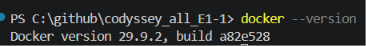
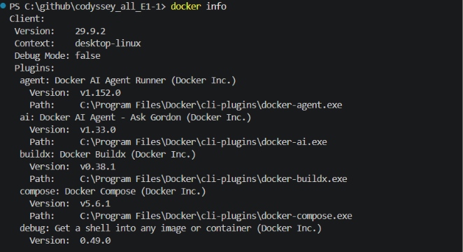
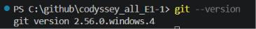

## 2. 저장소 구성 및 수행 체크리스트

```text
codyssey_all_E1-1/
├── README.md
├── dev-workspace/
│   ├── Dockerfile
│   └── site/index.html
├── image/                 # 명령 및 결과 캡처
├── permission.txt         # 권한 실습 파일
└── test.txt               # 파일 조작 실습 파일
```

[Dockerfile](dev-workspace/Dockerfile) · [웹 페이지 소스](dev-workspace/site/index.html) · [전체 증거](image/)

주요 수행 항목과 검증 결과는 다음과 같습니다.

- [x] 파일·디렉토리 생성, 내용 확인, 복사, 이름 변경, 삭제 — 3절
- [x] 파일·디렉토리 권한 변경 실습 — 4절
- [x] Docker 버전 확인, 이미지·컨테이너 운영 — 5절
- [x] hello-world 실행 및 출력 확인 — 5절
- [x] Ubuntu 내부 진입 및 명령 실행 — 5절
- [x] Dockerfile 작성, 커스텀 이미지 빌드·실행 — 6절
- [x] 포트 매핑 2회 및 브라우저 접속 — 6절
- [x] 바인드 마운트 연결 및 변경된 페이지 확인 — 7절
- [x] 볼륨 생성 및 컨테이너 삭제 전후 데이터 유지 — 8절
- [x] Git 사용자·기본 브랜치 설정, GitHub 원격 연결 및 커밋 목록 기록 — 9절

## 3. 터미널 기본 조작

WSL에서 저장소 루트를 기준으로 수행한 명령입니다. 출력이 없는 명령은 정상 수행 시 별도 메시지를 출력하지 않습니다.

```bash
touch test.txt
echo "hello codyssey" > test.txt
cat test.txt
# hello codyssey
cp test.txt copy.txt
mv copy.txt renamed.txt
rm renamed.txt
mkdir temp
rmdir temp
touch permission.txt
```

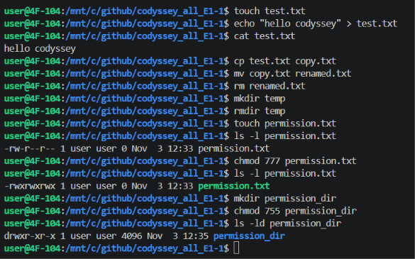

현재 경로·숨김 파일 포함 목록·디렉토리 이동은 다음 명령으로 재현할 수 있습니다.

```bash
pwd
ls -la
cd dev-workspace
pwd
cd ..
```

절대 경로 `/mnt/c/github/codyssey_all_E1-1/dev-workspace`는 루트부터의 전체 위치입니다. 상대 경로 `dev-workspace`는 현재 디렉토리를 기준으로 하며 `..`는 상위 디렉토리입니다. 다른 PC에서는 저장소를 복제한 위치에 맞춰 경로를 바꿉니다.

## 4. 파일과 디렉토리 권한

```bash
ls -l permission.txt
# -rw-r--r-- 1 user user 0 Nov 3 12:33 permission.txt
chmod 777 permission.txt
ls -l permission.txt
# -rwxrwxrwx 1 user user 0 Nov 3 12:33 permission.txt
mkdir permission_dir
chmod 755 permission_dir
ls -ld permission_dir
# drwxr-xr-x 1 user user 4096 Nov 3 12:35 permission_dir
```

[권한 변경 증거](image/파일및디렉토리조작_권한변경.png)에서 파일은 `644 → 777` 변경 전후를 확인할 수 있습니다. 디렉토리는 `chmod 755`로 설정하고 `ls -ld`로 권한을 확인했습니다. 빈 `permission_dir`는 Git에 저장되지 않으므로 재현할 때 생성합니다.

| 표기 | 의미 |
| --- | --- |
| r = 4 | 읽기, 디렉토리 항목 목록 조회 |
| w = 2 | 쓰기, 디렉토리 항목 생성·삭제 등에 관여 |
| x = 1 | 실행, 디렉토리 진입·경로 탐색 |
| 755 | 소유자 rwx / 그룹 r-x / 기타 r-x |
| 644 | 소유자 rw- / 그룹 r-- / 기타 r-- |
| 777 | 모두 rwx, 이번에는 권한 변경 관찰용으로 사용 |

세 자리는 소유자·그룹·기타 사용자의 권한 합계입니다. WSL의 `/mnt/c`는 Windows 드라이브이므로 마운트 설정에 따라 권한 동작이 다를 수 있습니다. 동일하게 재현되지 않으면 WSL 홈 디렉토리에서 실습하고 마운트 옵션을 확인합니다.

## 5. Docker 기본 운영

### 이미지·컨테이너 확인

```bash
docker images
# hello-world:latest, ubuntu:latest,
# my-custom-nginx:1.0, docker/welcome-to-docker:latest 확인
docker ps
# 캡처 시점에는 실행 중인 컨테이너 없음
docker ps -a
# 직접 실행한 Ubuntu 컨테이너 확인
# CONTAINER ID: fe66e56f04d8 / IMAGE: ubuntu / COMMAND: "bash"
# STATUS: Exited (0) 17 minutes ago
```

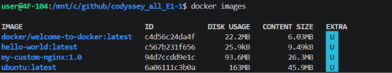
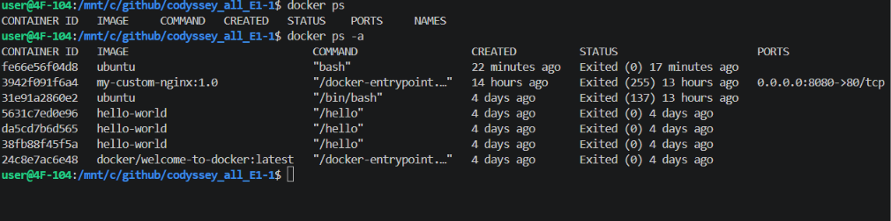

`docker ps -a`에서 직접 실행한 Ubuntu 컨테이너 `fe66e56f04d8`을 확인했습니다. 실행 명령은 `bash`이며, 캡처 시점의 상태는 `Exited (0)`으로 정상 종료된 상태였습니다.

### hello-world 실행 확인

Windows PowerShell에서 다음 명령으로 hello-world 이미지를 직접 실행하고 출력 메시지를 확인했습니다. 아래는 실행 캡처에 표시된 명령과 출력입니다.

```text
PS C:\codyssey\allin\codyssey_all_E1-1> docker run --rm hello-world

Hello from Docker!
This message shows that your installation appears to be working correctly.
```

`Hello from Docker!` 메시지를 통해 hello-world 실행을 확인했습니다. `--rm` 옵션은 실행이 끝난 컨테이너를 자동으로 삭제합니다.

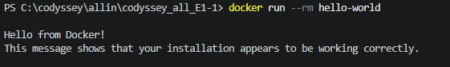

### Ubuntu 내부 진입 및 실행·중지

```bash
docker run -it --name ubuntu-JBC ubuntu bash
# 아래는 컨테이너 내부 명령
pwd
# /
ls
# bin boot dev etc home lib ... usr var
echo "hello ubuntu"
# hello ubuntu
exit

# 아래는 호스트 명령
docker start ubuntu-JBC
# ubuntu-JBC
docker exec -it ubuntu-JBC bash
# root@<container-id>:/# 프롬프트 진입
# 작업 후 exit로 호스트에 복귀
exit
docker stop ubuntu-JBC
# ubuntu-JBC
```

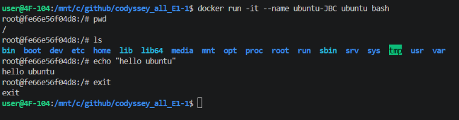
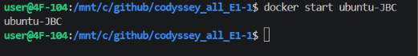
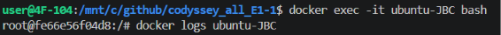
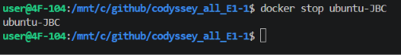

최초 `run -it ... bash`에서는 Bash가 주 프로세스여서 `exit`하면 컨테이너가 종료됩니다. `exec`는 실행 중인 컨테이너에 별도 프로세스를 생성하므로 해당 쉘을 종료해도 주 프로세스가 살아 있으면 컨테이너는 유지됩니다. `attach`는 기존 주 프로세스의 입출력에 연결하여 종료 입력이 주 프로세스에 영향을 줄 수 있습니다. 이번 실습에서는 run·exit·start·exec 동작을 관찰했습니다.

### 로그·리소스 확인

```bash
docker logs ubuntu-JBC
# pwd, ls, echo 실행 내역과 hello ubuntu 출력 확인
docker stats --no-stream
# ubuntu-JBC: CPU 0.00%, 메모리 9.914MiB / 7.605GiB
```

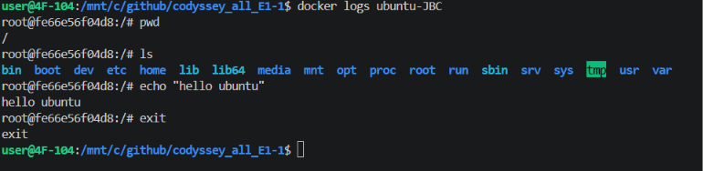
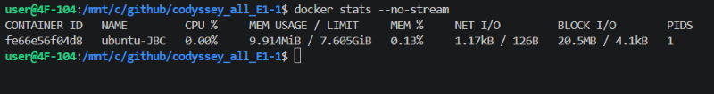

## 6. Dockerfile로 커스텀 웹 서버 제작

웹 서버 베이스 이미지 `nginx:alpine`을 사용하고 정적 콘텐츠를 교체했습니다.

```dockerfile
FROM nginx:alpine

LABEL maintainer="developer"

COPY site/ /usr/share/nginx/html/

EXPOSE 80
```

| 설정 | 목적 |
| --- | --- |
| FROM | NGINX가 준비된 Alpine 기반 이미지 활용 |
| LABEL | 관리 주체 메타데이터 추가 |
| COPY | 기본 페이지 대신 직접 작성한 HTML 포함 |
| EXPOSE | 서비스 포트 명시, 실제 호스트 연결은 -p로 설정 |

Docker Desktop을 실행하고 WSL에서 Docker 명령 사용이 가능한 상태에서, 저장소 루트부터 실행합니다. 동일한 이름의 컨테이너가 있다면 새 이름을 사용합니다. 호스트 포트가 사용 중이면 [10절의 포트 충돌 대응 절차](#사례-3-호스트-포트-충돌-시-대응-절차)에 따라 점유 주체를 확인하고 포트를 해제하거나 다른 호스트 포트를 사용합니다.

```bash
cd dev-workspace
docker build -t jbc-web:1.0 .
# [+] Building 1.9s (7/7) FINISHED
# naming to docker.io/library/jbc-web:1.0

docker run -d -p 8080:80 --name jbc-web jbc-web:1.0
curl http://localhost:8080
# HTML 응답: <h1>Hello Docker!</h1>
# 당시 본문: <p>My Development Workspace</p>

docker run -d -p 8081:80 --name jbc-web-2 jbc-web:1.0
curl http://localhost:8081
# 동일한 HTML 응답 확인
```

컨테이너는 격리된 네트워크를 사용합니다. `-p 8080:80`은 호스트 8080번 요청을 컨테이너 80번으로 전달합니다. 동일한 이미지로 생성한 두 컨테이너가 각각 8080·8081에서 응답했습니다.

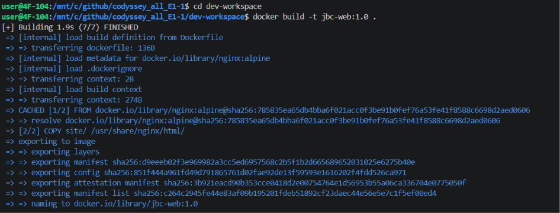
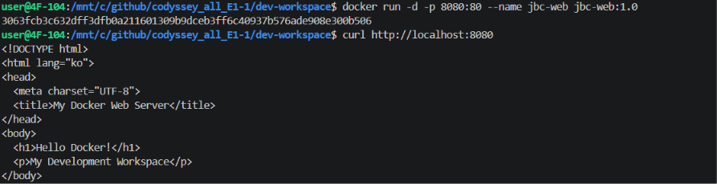
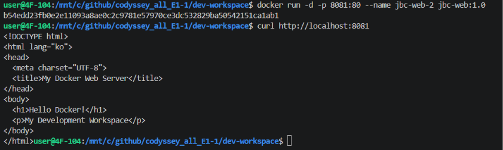
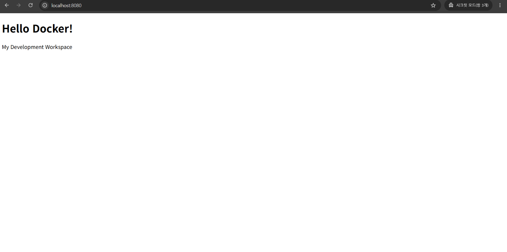

현재 저장된 HTML은 바인드 마운트 실습 후의 `My Development Workspace Bind` 문구를 포함합니다. 현재 소스로 다시 빌드하면 과거 캡처와 달리 `Bind`가 표시되는 것이 정상입니다. 이미지에 COPY한 파일은 호스트 파일만 수정해도 바뀌지 않으며 다시 빌드해야 합니다.

## 7. 바인드 마운트로 변경 반영

`dev-workspace`에서 호스트의 site 폴더를 컨테이너 문서 루트에 연결했습니다.

```bash
docker run -d \
  --name bind-web \
  -p 8082:80 \
  -v "$(pwd)/site:/usr/share/nginx/html:ro" \
  nginx:alpine
```

위 명령은 Bash 문법입니다. PowerShell에서는 같은 폴더에서 다음 대체 명령을 사용할 수 있습니다.

```powershell
docker run -d --name bind-web -p 8082:80 --mount "type=bind,source=$($PWD.Path)/site,target=/usr/share/nginx/html,readonly" nginx:alpine
```

| 비교 | 본문 | 증거 |
| --- | --- | --- |
| 변경 전 | My Development Workspace | [8080 응답](image/docker_이미지빌드및실행2.png) |
| 변경 후 | My Development Workspace Bind | [8082 화면](image/docker_바인드마운트_브라우저화면.png) |

변경 전은 이미지에 복사된 페이지이며 변경 후는 호스트 폴더를 연결한 페이지입니다. 재현 시 `site/index.html`을 수정하고 새로고침하거나 다음 명령으로 응답을 비교합니다.

```bash
curl http://localhost:8082
```

`ro`는 컨테이너에서 읽기 전용이라는 뜻입니다. 호스트에서는 수정 가능하며, 변경 내용은 이미지 재빌드 없이 제공됩니다.

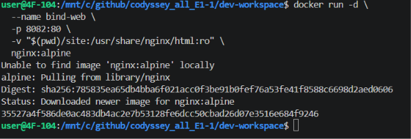
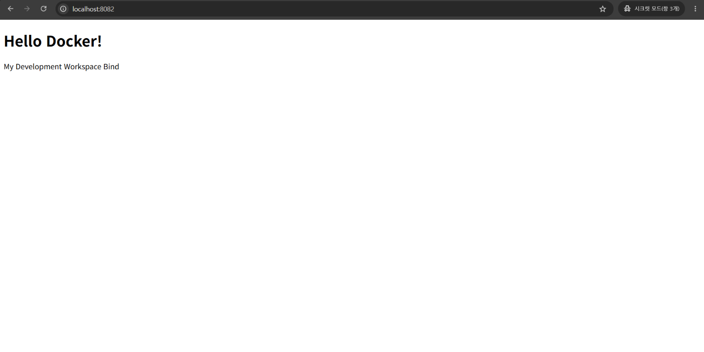

## 8. Docker 볼륨 영속성 검증

이름 있는 볼륨 mydata에 저장한 파일이 컨테이너 삭제 후에도 유지되는지 확인했습니다.

```bash
docker volume create mydata
# mydata
docker run -d --name vol-test \
  -v mydata:/data \
  ubuntu sleep infinity
docker exec vol-test \
  sh -c 'echo "persistent Data" > /data/test.txt'
docker exec vol-test cat /data/test.txt
# persistent Data

docker rm -f vol-test
# vol-test
docker run -d --name vol-test2 \
  -v mydata:/data \
  ubuntu sleep infinity
docker exec vol-test2 cat /data/test.txt
# persistent Data
```

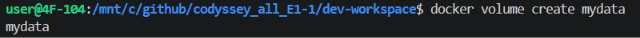
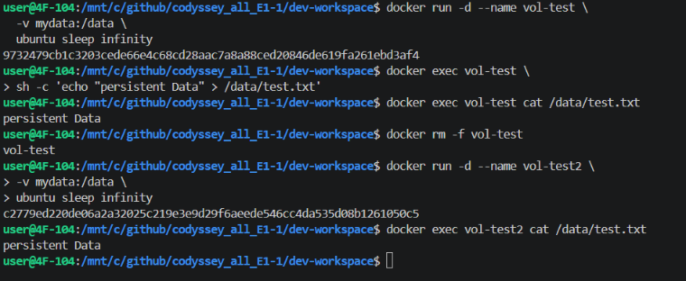

삭제 전후 동일한 데이터가 출력되었습니다. 컨테이너와 별도로 관리되는 볼륨에 저장했기 때문에 컨테이너를 교체해도 데이터가 유지됩니다. 바인드 마운트는 호스트의 특정 경로를 직접 연결하며, 이름 있는 볼륨은 Docker가 저장 위치를 관리합니다.

### 중요 데이터 백업 권장 방법

볼륨의 영속성은 별도 백업을 대신하지 않습니다. 볼륨 자체의 삭제나 저장 장치 장애에 대비해 중요한 데이터는 정기적으로 백업하는 것을 권장합니다. 백업 전에는 해당 볼륨에 쓰는 애플리케이션을 중지하여 데이터가 변경되지 않게 하고, 임시 컨테이너에 `mydata`를 읽기 전용으로 연결해 `tar` 압축 파일을 호스트 폴더에 저장합니다. 백업 파일은 날짜별로 보관하고 외부 저장 장치 등 별도 위치에도 복사합니다. 바인드 마운트를 사용하는 데이터는 연결된 호스트 폴더를 같은 방식으로 별도 백업합니다. 복원 검증은 원본을 덮어쓰지 않도록 새 볼륨에서 수행하며, 데이터베이스는 해당 제품의 전용 백업 도구를 우선 사용합니다.

아래는 WSL Bash에서 사용할 수 있는 백업·복원 권장 절차이며, 실제 수행 결과를 기록한 로그는 아닙니다. 기존 `mydata` 볼륨이 있는지 먼저 확인하고, 이 볼륨에 대한 쓰기를 중지한 상태에서 실행합니다.

```bash
docker volume inspect mydata
mkdir -p backups
backup_file="mydata-$(date +%Y%m%d-%H%M%S).tar.gz"

# 기존 볼륨을 읽기 전용으로 연결하여 호스트의 backups 폴더에 백업
docker run --rm \
  -v mydata:/data:ro \
  -v "$(pwd)/backups:/backup" \
  ubuntu tar czf "/backup/$backup_file" -C /data .

# 생성된 파일 및 아카이브 내용 확인
ls -lh "backups/$backup_file"
tar tzf "backups/$backup_file"

# 사용하지 않은 새 이름의 볼륨에 복원하여 원본과 별도로 검증
restore_volume="mydata-restore-$(date +%Y%m%d-%H%M%S)"
docker volume create "$restore_volume"
docker run --rm \
  -v "$restore_volume:/data" \
  -v "$(pwd)/backups:/backup:ro" \
  ubuntu tar xzf "/backup/$backup_file" -C /data

docker run --rm -v "$restore_volume:/data:ro" ubuntu cat /data/test.txt
```

마지막 `cat` 명령의 출력을 원본 `test.txt`의 내용과 비교하여 복원 여부를 확인합니다. 백업이 끝나면 중지했던 애플리케이션을 다시 실행합니다.

## 9. Git 설정 및 GitHub 연동

캡처에서 확인되는 주요 설정입니다. 이름과 이메일은 마스킹되어 있습니다.

```text
$ git config --list
init.defaultbranch=master
remote.origin.url=https://github.com/byeongchan/codyssey_all_E1-1
remote.origin.fetch=+refs/heads/*:refs/remotes/origin/*
branch.main.remote=origin
branch.main.merge=refs/heads/main
branch.main.vscode-merge-base=origin/main
user.name=<마스킹>
user.email=<마스킹>
```

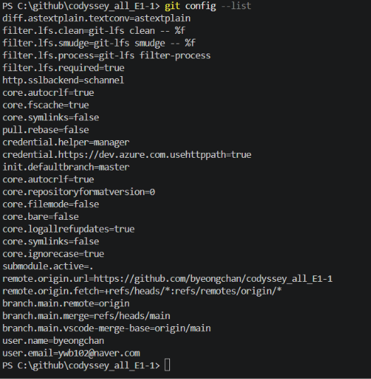

`init.defaultbranch=master`는 새 저장소의 기본값이며, 이 저장소의 원격 추적 설정은 main입니다. Git은 로컬 변경 이력·브랜치 관리 도구이고 GitHub는 원격 저장소 공유·협업 서비스입니다.

### 커밋 목록

VS Code의 Git 그래프에서 `main` 브랜치의 커밋 목록을 확인했습니다. 캡처에는 `Initial commit`, `도커 및 증명 스크린샷 첨부`, `이미지파일 변경`, `문서 수정` 등의 커밋이 표시됩니다.

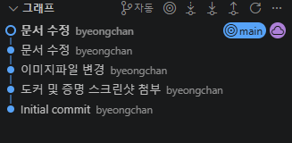

원격 저장소에 반영된 커밋은 [GitHub main 브랜치 커밋 히스토리](https://github.com/byeongchan/codyssey_all_E1-1/commits/main/)에서 확인할 수 있습니다.

### 다른 PC에서 재현하기

다른 PC에서 재현할 때는 본인의 정보로 설정합니다. 다음은 재현용 명령이며 기존 실습 출력이 아닙니다.

```bash
git config --global user.name "본인 이름"
git config --global user.email "본인 Git 이메일"
git config --global init.defaultBranch main
git clone https://github.com/byeongchan/codyssey_all_E1-1.git
cd codyssey_all_E1-1
git remote -v
git status
```

캡처·로그에 토큰, 비밀번호, 개인키, 인증 코드를 포함하지 않습니다.

## 10. 트러블슈팅 및 재현 시 대응

웹 콘텐츠 갱신, 명령 실행 위치, 포트 충돌에 관한 확인·대응 방법을 정리했습니다.

### 사례 1. 파일 수정 후에도 이전 웹 페이지가 나오는 경우

- **문제:** 현재 HTML에는 Bind가 있지만 초기 빌드·접속 캡처에는 없습니다.
- **원인 가설:** COPY 시점의 파일이 이미지에 저장되어 기존 컨테이너가 이전 내용을 제공합니다.
- **확인:** `cat site/index.html`과 `curl http://localhost:8080`을 비교하고 `docker inspect jbc-web`으로 마운트를 확인합니다.
- **해결/대안:** 이미지를 다시 빌드해 새 컨테이너로 실행하거나 바인드 마운트를 사용합니다. [8082 결과](image/docker_바인드마운트_브라우저화면.png)에는 변경된 Bind 문구가 표시됩니다.

### 사례 2. 컨테이너 안에서 Docker 운영 명령을 입력한 경우

- **문제:** [내부 진입 캡처](image/docker_컨테이너내부진입.png)에 컨테이너 프롬프트에서 `docker logs ubuntu-JBC`를 입력한 상태가 보입니다.
- **원인 가설:** exec 이후 호스트와 컨테이너의 실행 위치를 혼동할 수 있습니다. 기본 Ubuntu 이미지에는 Docker CLI가 준비되어 있지 않습니다.
- **확인:** 호스트의 `user@...:/mnt/c/...$`와 컨테이너의 `root@...:/#` 프롬프트를 구분하고, 필요하면 `command -v docker`로 실행 파일 유무를 확인합니다.
- **해결/대안:** `exit`로 호스트에 복귀한 뒤 `docker logs ubuntu-JBC`를 실행합니다. [로그 캡처](image/docker_컨테이너로그.png)에서는 호스트에서 조회에 성공한 결과를 확인할 수 있습니다.

### 사례 3. 호스트 포트 충돌 시 대응 절차

다음은 재현 시 사용할 대응 절차이며, 실제로 포트 충돌을 겪거나 해결했다는 수행 기록은 아닙니다.

1. **문제와 원인 가설:** `docker run -p 8080:80 ...` 실행 시 `port is already allocated` 또는 `address already in use` 오류가 발생하면 다른 컨테이너나 호스트 프로세스가 8080 포트를 점유하는지 확인합니다.

2. **점유 컨테이너 확인:** PowerShell 또는 WSL에서 아래 명령을 실행하고 `PORTS`에 `8080->80/tcp` 등 호스트 8080 포트 매핑이 있는지 확인합니다.

   ```bash
   docker ps --format "table {{.Names}}\t{{.Ports}}"
   ```

3. **점유 프로세스 확인:** Windows PowerShell에서 리스닝 포트와 프로세스 ID를 확인합니다. 두 번째 명령의 `1234`는 조회된 실제 `OwningProcess` 값으로 바꿉니다. 조회 결과가 없으면 해당 시점에 일치하는 리스너가 없는 것입니다.

   ```powershell
   Get-NetTCPConnection -LocalPort 8080 -State Listen |
     Select-Object LocalAddress, LocalPort, OwningProcess
   Get-Process -Id 1234
   ```

   WSL 내부의 리스닝 포트는 WSL Bash에서 다음으로 확인할 수 있습니다. WSL에서 결과가 없어도 Windows 측 점유는 위 PowerShell 명령으로 별도 확인합니다.

   ```bash
   ss -ltnp 'sport = :8080'
   ```

4. **포트 해제 또는 재할당:** 불필요한 실습 컨테이너라면 `docker stop <확인한_컨테이너명>`으로 중지하고, 일반 프로그램이라면 해당 프로그램을 정상 종료합니다. 중지 후 위 조회 명령으로 해제 여부를 다시 확인합니다. 계속 사용해야 하는 서비스라면 종료하지 않고 8083 등 다른 호스트 포트를 선택합니다. 새 포트도 2~3단계의 조회 명령에서 포트 번호를 바꿔 사용 여부를 먼저 확인합니다.

5. **새 컨테이너 실행 및 접속 검증:** `jbc-web:1.0` 이미지가 빌드된 상태에서 아래 예시처럼 사용하지 않은 컨테이너 이름과 호스트 포트로 실행합니다. 실패한 실행이 같은 이름의 컨테이너를 남겼다면 `docker ps -a`로 확인하고 새 이름을 사용합니다. `8083:80`은 호스트 포트만 8083으로 바꾸며 NGINX의 컨테이너 포트 80은 유지합니다.

   ```bash
   docker run -d -p 8083:80 --name jbc-web-8083 jbc-web:1.0
   docker ps --format "table {{.Names}}\t{{.Ports}}"
   ```

   Windows PowerShell에서는 `curl.exe http://localhost:8083`, WSL Bash에서는 `curl http://localhost:8083`으로 HTML 응답을 확인합니다.
